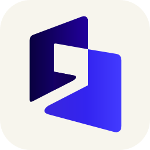
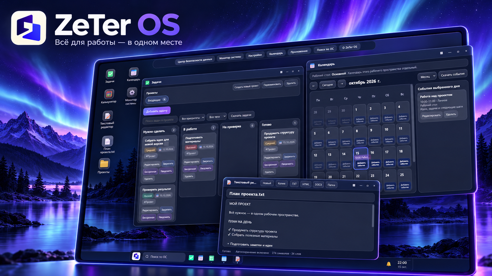

**Язык / Language:** **Русский** · [English](README_EN.md)

  

# ZeTer OS

**Настольное рабочее пространство с интерфейсом операционной системы — в Windows и браузере.**

Рабочие столы · окна и «Пуск» · Проводник · заметки и задачи · файлы · резервные копии

[🚀 Запустить онлайн](https://dkl.do.am/zeteros/index.html) · [⬇️ Скачать Windows-версию](https://github.com/zeter1/ZeTer-OS/releases) · [📋 История изменений](CHANGELOG.md) · [🐞 Сообщить об ошибке](https://github.com/zeter1/ZeTer-OS/issues)

ZeTer OS — не отдельная операционная система и **не замена Windows**. Это приложение-оболочка, объединяющее повседневные инструменты в привычном интерфейсе с рабочим столом, окнами и меню «Пуск». Одна HTML/CSS/JavaScript-оболочка работает в браузере и в Windows-приложении, где Python и `pywebview` предоставляют локальное хранение и дополнительные возможности.

> **Состояние проекта.** Готовые Windows-сборки опубликованы как **Prerelease** (предварительные версии). Перед обновлением или переносом сохраняйте данные. Версия исходников определяется в [`app/js/core/version.js`](app/js/core/version.js); она может отличаться от последнего [Windows-релиза](https://github.com/zeter1/ZeTer-OS/releases) и версии сайта на uCoz.

## Содержание

- [Быстрый старт](#быстрый-старт)
- [Возможности и сценарии](#возможности-и-сценарии)
- [Различия Windows и браузера](#различия-windows-и-браузера)
- [Установка Windows-версии](#установка-windows-версии)
- [Работа с данными и резервными копиями](#работа-с-данными-и-резервными-копиями)
- [Обновления и история изменений](#обновления-и-история-изменений)
- [Решение проблем](#решение-проблем)
- [Разработка и архитектура](#разработка-и-архитектура)
- [Проверки и сборка](#проверки-и-сборка)
- [Ограничения и связь](#ограничения-и-связь)

## Быстрый старт

| Задача | Что выбрать | Что понадобится |
| --- | --- | --- |
| Просто посмотреть ZeTer OS | **[Открыть в браузере](https://dkl.do.am/zeteros/index.html)** | Современный браузер, без установки |
| Работать локально в Windows | **[Windows x64 ZIP из Releases](https://github.com/zeter1/ZeTer-OS/releases)** | Распаковать ZIP, WebView2 Runtime |
| Изменять код или изучать проект | **[Запуск из исходников](#разработка-и-архитектура)** | Windows, Python 3, зависимости |
| Узнать, что изменилось | **[CHANGELOG.md](CHANGELOG.md)** | Ничего скачивать не нужно |

**Первое знакомство:**
1. Откройте веб-версию или запустите `ZeTer-OS.exe` из распакованного Windows-архива.
2. Выполните первоначальную настройку, создайте или выберите рабочий стол.
3. Откройте «Пуск» и запустите нужные приложения; окна можно организовать в рабочем пространстве.
4. Перед работой с важными данными познакомьтесь с экспортом и резервными копиями.

Для браузера достаточно [ссылки на приложение](https://dkl.do.am/zeteros/index.html). **Не открывайте `app/index.html` двойным щелчком как замену штатного запуска desktop-версии**: при таком открытии не будет Python bridge.

## Возможности и сценарии

| Направление | Что доступно |
| --- | --- |
| **Рабочее пространство** | Несколько рабочих столов, окна, Проводник, папки, ярлыки, панель задач, меню «Пуск», настройка оформления |
| **Личная продуктивность** | Заметки, календарь, задачи, проекты, категории, доска и списки |
| **Контент и информация** | Работа с файлами, таблицами и изображениями, библиотеки ссылок и AI-промптов |
| **Учёт времени** | Таймер с паузой, ручные записи, привязка к задачам и проектам, журнал, недельная статистика, CSV |
| **Рабочие расчёты** | Набор настраиваемых карточек бизнес-калькуляторов |
| **Инструменты системы** | Настройки, сочетания клавиш, уведомления, системный монитор и графики |
| **Сохранность работы** | Локальное состояние, экспорт, резервные копии, точки восстановления, «Центр безопасности» |

### Примеры использования

**Планирование дня:** создать задачу и проект, добавить событие в календарь, включить таймер, затем посмотреть журнал времени.

**Единое место для материалов:** держать заметки, документы, изображения, таблицы, ссылки и библиотеку промптов в одном рабочем пространстве.

**Своя рабочая среда:** настроить рабочие столы, ярлыки и оформление; пользоваться меню «Пуск» и окнами вместо постоянного переключения отдельных вкладок.

Окончательный набор функций зависит от версии и режима запуска. Актуальные подробности — во [встроенной справке](app/js/core/help-content.js) и [CHANGELOG.md](CHANGELOG.md).

## Различия Windows и браузера

| Возможность | Windows EXE / Python desktop | Браузер / PWA |
| --- | --- | --- |
| Интерфейс и основные web-приложения | Да | Да |
| Установка Python пользователем | **Нет для готового EXE** | Нет |
| Основные данные | Локальный файл `data/zeter-os-state.json` | IndexedDB сайта |
| Интеграция с Windows и native API | Через `pywebview` | Нет |
| Работа с локальными документами | Больше возможностей через desktop bridge | Ограничена браузерными API |
| Проверка обновлений | Через канал Windows-сборок | Через обновление web-ресурсов |
| Автоматическая синхронизация между режимами | **Нет** | **Нет** |

В Windows-версии для **редактирования импортированных DOC/DOCX** требуется отдельно установленный **LibreOffice**. В браузере некоторые функции могут быть недоступны или работать иначе.

**Веб-адрес:** https://dkl.do.am/zeteros/index.html. Версия сайта обновляется отдельно от GitHub Releases; данные находятся в хранилище браузера для конкретного сайта и профиля. Удаление данных сайта или профиля может привести к потере работы.

## Установка Windows-версии

### 1. Скачивание и запуск

1. Откройте [GitHub Releases](https://github.com/zeter1/ZeTer-OS/releases) и выберите нужную сборку.
2. В разделе **Assets** скачайте **`ZeTer-OS-<версия>-Windows-x64.zip`** (не `Source code.zip`).
3. Полностью распакуйте ZIP в отдельный каталог, например `C:\Apps\ZeTer-OS`. Не запускайте EXE прямо из архива.
4. Запустите `ZeTer-OS.exe`. Храните рядом все DLL, папку `app/`, файл `zeter-update.json` и остальные файлы комплекта.

**Python отдельно ставить не нужно:** исполняемая Windows-сборка уже содержит необходимые Python runtime-файлы. Однако для встроенного окна требуется **Microsoft Edge WebView2 Runtime**. Если его нет, установите [официальный WebView2 Runtime](https://developer.microsoft.com/en-us/microsoft-edge/webview2/). Для исходников установка Python, напротив, необходима.

Приложение поставляется без цифровой подписи издателя: Windows/SmartScreen может предупреждать о неизвестном издателе. Загружайте сборки только из [официальных Releases проекта](https://github.com/zeter1/ZeTer-OS/releases).

### 2. Проверка SHA-256 — необязательна

В Assets рядом с ZIP может находиться `ZeTer-OS-<версия>-Windows-x64.sha256.txt`. **Для запуска он не нужен.** Это контрольная сумма для проверки скачанного архива.

~~~powershell
Get-FileHash .\ZeTer-OS-*-Windows-x64.zip -Algorithm SHA256
~~~

Сравните значение `Hash` со значением внутри файла `.sha256.txt` **того же релиза**. Если они не совпадают, архив не следует использовать — скачайте его заново. Совпадение проверяет целостность относительно опубликованной суммы, но само по себе не удостоверяет издателя.

### 3. Обновление или перенос вручную

Если штатное обновление недоступно или вы переносите приложение на другой компьютер:

1. В работающей старой версии создайте **экспорт/ZIP-бэкап**, затем закройте приложение.
2. Сохраните отдельно всю фактическую папку пользовательских данных `data/`. Если путь данных переносился в настройках, проверьте именно активный путь.
3. Скачайте новую сборку и **распакуйте в новую пустую папку**. Не смешивайте файлы разных версий.
4. После полного закрытия старой программы перенесите сохранённые пользовательские данные согласно [модели хранения](docs/DATA_MODEL.md), не перезаписывая их пустыми файлами.
5. Запустите новую версию, проверьте состояние, версию и необходимые приложения; только после проверки удаляйте старую копию. При необходимости обновите ярлык и автозапуск.

Подробнее о безопасном обновлении, проверке ZIP и восстановлении — [docs/UPDATES.md](docs/UPDATES.md).

## Работа с данными и резервными копиями

**Важно:** данные Windows-приложения и сайта **не синхронизируются автоматически**. Перед переустановкой Windows, очисткой браузера, сменой компьютера и обновлением приложения сохраняйте проверяемую резервную копию.

| Где запущено | Где искать |
| --- | --- |
| Windows EXE или запуск из Python | `data/zeter-os-state.json` — основной state (путь может быть изменён) |
| Windows-резервные копии | `data/backups/` |
| Браузер | IndexedDB текущего профиля и origin сайта |
| Журналы Windows-версии | `Логи проблем/latest_run.json` и указанный им сеанс |

**Безопасное правило восстановления:** сначала сделайте копию текущего состояния, даже если оно повреждено. Затем выберите подходящий backup и выполните восстановление осознанно; программа не обязана автоматически заменять state резервной копией. Если восстановление не удалось, сохраните исходный файл и журналы для диагностики.

Нельзя бездумно удалять `data/`, `data/backups/`, IndexedDB или PWA-кэш «для исправления ошибки»: это может уничтожить единственный экземпляр пользовательских данных.

Технические детали: [модель данных](docs/DATA_MODEL.md) · [жизненный цикл состояния](docs/STATE_LIFECYCLE.md) · [диагностика](docs/TROUBLESHOOTING.md).

## Обновления и история изменений

**Windows EXE.** Приложение проверяет файл `updates.json` на GitHub Pages при запуске, периодически и по ручному запросу. Если версия новее, показывает предложение; **скачивание ZIP из GitHub Releases и установка требуют действий пользователя**. Пакет проверяется перед заменой, предусмотрены сохранение пользовательского состояния и восстановление/откат при ошибках. Не все старые EXE поддерживают текущий механизм обновлений. [Подробный контракт обновлений](docs/UPDATES.md).

**Веб-версия.** Опубликованный на uCoz набор ресурсов проверяется при открытии/обновлении страницы; уже открытая вкладка может показать уведомление. После крупной смены версии иногда нужно закрыть старые вкладки и заново открыть сайт. Не очищайте хранилище сайта, не сделав копию данных. [Публикация и обновление веб-версии](docs/UCOZ.md).

**Исходники Python.** Обновляются отдельно разработчиком — механизм обновлений EXE не обновляет checkout Git.

### Версии и история изменений

- [**CHANGELOG.md**](CHANGELOG.md) — история функций, исправлений и изменений.
- [**Releases**](https://github.com/zeter1/ZeTer-OS/releases) — опубликованные Windows ZIP, SHA-256 и дата релиза.
- [**RELEASE_NOTES_RU.md**](RELEASE_NOTES_RU.md) — примечания к Windows-сборке.
- [**`version.js`**](app/js/core/version.js) — версия исходного web-приложения в `main`.

**Важно различать:** коммит в `main`, опубликованный Windows ZIP и файлы на uCoz могут иметь разные даты и версии.

## Решение проблем

| Симптом | Что проверить в первую очередь |
| --- | --- |
| `ZeTer-OS.exe` не открывается | Весь ли ZIP распакован; присутствуют ли `app/` и DLL; установлен ли WebView2 Runtime |
| Исчезли данные | Тот ли экземпляр программы и профиль браузера; не менялся ли каталог `data/`; есть ли backups |
| Сайт показывает старый интерфейс | Перезагрузите страницу; закройте старые вкладки; проверьте опубликованную версию, **не удаляя IndexedDB** |
| Не работает Windows-функция в браузере | Проверьте [различия режимов](#различия-windows-и-браузера): Python bridge в браузере отсутствует |
| Не удаётся проверить/установить обновление | Проверьте соединение и [диагностику обновлений](docs/UPDATES.md); не удаляйте `data/updates/` |
| Приложение зависает или выдаёт ошибку | Начните с `Логи проблем/latest_run.json` и [руководства по диагностике](docs/TROUBLESHOOTING.md) |

### Как сообщить о баге

Создайте [GitHub Issue](https://github.com/zeter1/ZeTer-OS/issues), указав **версию**, **режим** (Windows EXE, Python или сайт), **шаги воспроизведения**, **ожидаемый и фактический результат**. При необходимости добавьте **обезличенные** данные из `Логи проблем/`: указатель `latest_run.json`, `summary.json` и нужный фрагмент `problems.jsonl` или `events.jsonl`. Для старых сборок возможен `data/logs/zeter-os.log`.

**Не публикуйте** файлы `data/` целиком, документы, экспортированные архивы, токены, личную информацию и необработанные журналы. Смотрите [SUPPORT.md](SUPPORT.md), [SECURITY.md](SECURITY.md) и [контракт диагностики](<Логи проблем/README_FOR_CODEX.md>).

## Разработка и архитектура

**Технологии:** Python 3 · `pywebview` · HTML · CSS · JavaScript · IndexedDB · локальный HTTP · GitHub Actions · PyInstaller (упаковка Windows EXE).

### Запуск из исходников

Нужны **Windows**, **Python 3** и Git (для команды clone). В CI применяется **Python 3.13**. Из PowerShell:

~~~powershell
git clone https://github.com/zeter1/ZeTer-OS.git
cd ZeTer-OS
py -3 -m pip install -r requirements.txt
py -3 run_zeter_os.py
~~~

Также доступен `start_zeter_os.cmd`. Здесь устанавливается `pywebview` из `requirements.txt` — **это не тот же формат, что готовый EXE**. Подробное руководство: [README_PYTHON.md](README_PYTHON.md).

### Как устроен проект

~~~text
ZeTer-OS/
├── run_zeter_os.py        # native launcher, HTTP-сервер, Python bridge
├── problem_logs.py        # структурированные журналы диагностики
├── app_updater.py         # обнаружение и загрузка обновлений
├── update_runner.py       # замена файлов и откат
├── app/
│   ├── index.html         # единая web-оболочка
│   ├── service-worker.js  # согласованный PWA-кэш
│   ├── css/               # тематические CSS-модули
│   └── js/
│       ├── app.js         # composition root и связывание компонентов
│       └── core/          # модули интерфейса и предметной логики
├── docs/                  # архитектура, контракты, эксплуатация
├── tools/                 # проектные проверки и инструменты сборки
├── build_exe.bat          # нативная Windows-сборка
├── build_release.cmd      # отдельный portable ZIP для Python
└── check_project.cmd      # локальная проверка проекта
~~~

**Поток исполнения:** `run_zeter_os.py` запускает локальный HTTP-сервер и окно `pywebview` → загружается `app/index.html` → `app/js/app.js` связывает state, DOM и модули `app/js/core/` → при native-запуске доступен Python bridge, в браузере вместо него используется web-хранилище. Обновление EXE выполняется отдельно от обычного состояния приложения.

**Навигация для разработчика:** [обзор архитектуры](docs/ARCHITECTURE.md) · [карта кода](docs/CODEMAP.md) · [индекс core API](docs/CORE_API_INDEX.md) · [native bridge](docs/NATIVE_BRIDGE.md) · [модель данных](docs/DATA_MODEL.md) · [индекс документации](docs/README.md) · [правила проекта](AGENTS.md).

## Проверки и сборка

Для JS smoke-тестов нужен **Node.js 22**. Из корня проекта:

~~~powershell
python tools/check_project.py
node tools/run_smokes.js
.\check_project.cmd --strict-node --no-pause
~~~

В [CI GitHub Actions](https://github.com/zeter1/ZeTer-OS/actions/workflows/ci.yml) на Windows выполняются компиляция Python и строгая проверка структуры/контрактов. **Нативная упаковка EXE запускается отдельно** (ручной `workflow_dispatch` или коммит со специальной меткой `[package]`); обычное изменение README не публикует релиз.

| Что собрать | Инструмент | Результат |
| --- | --- | --- |
| Windows EXE с runtime | [`build_exe.bat`](BUILD_EXE.md) | `dist/ZeTer-OS/` с `ZeTer-OS.exe` |
| Python portable ZIP | `build_release.cmd` | Другой формат, для запуска через Python |
| Файлы для uCoz | `prepare_web.cmd` или `build_ucoz.cmd` | Web-публикация, **не Windows EXE** |

Автоматические проверки и packaged self-test **не заменяют** ручной запуск окна, проверку диалогов, сохранения и обновления на Windows. [Тестовая стратегия](docs/TESTING.md) · [сборка EXE](BUILD_EXE.md) · [публикация uCoz](docs/UCOZ.md).

## Ограничения и связь

- **Prerelease:** проект находится в стадии тестирования; используйте backups для важных данных.
- **Без цифровой подписи EXE:** Windows может предупреждать о неизвестном издателе.
- **Нет автоматической синхронизации** между браузером и desktop; native-функции доступны не везде.
- **Нет открытой лицензии:** доступность исходников на GitHub не означает разрешения свободно копировать, изменять или распространять код.

**Разработчик:** [GitHub zeter1](https://github.com/zeter1) · [Email](mailto:zeter11@gmail.com) · [Telegram](https://t.me/zeter1) · [сообщество Telegram](https://t.me/zeterchat) · [LinkedIn](https://www.linkedin.com/in/zeter/)

Другие профили: [Facebook](https://www.facebook.com/zeter1) · [ВКонтакте](https://vk.ru/zeter1) · [Instagram](https://www.instagram.com/zeter1992/) · [TenChat](https://tenchat.ru/zeter) · [X](https://x.com/zeter1) · [Threads](https://www.threads.com/@zeter1992) · [Одноклассники](https://ok.ru/zeter1).

Если хотите предложить улучшение или нашли ошибку, используйте [Issues](https://github.com/zeter1/ZeTer-OS/issues).
